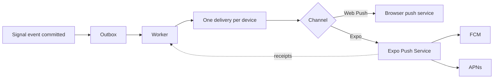

# Mobile app

The primary product: native Android and iOS apps for subscribers and administrators, in `apps/mobile`. React Native with Expo and
TypeScript, using native views, native navigation and native push. There is no WebView anywhere in it.

The app holds no business logic of its own. Levels, validation, previews and display rules come from `packages/domain`, the same
code the API and the web app use, and the server has the final say on everything.

## Run it

You need the API running somewhere the phone can reach. **`localhost` on a phone means the phone**, not your computer.

| Where the app runs                 | API address                        | Also needed                               |
| ---------------------------------- | ---------------------------------- | ----------------------------------------- |
| Android emulator                   | `http://localhost:4000`            | `adb reverse tcp:4000 tcp:4000`           |
| Android emulator, no `adb reverse` | `http://10.0.2.2:4000`             |                                           |
| iOS simulator                      | `http://localhost:4000`            | A Mac with Xcode                          |
| A real phone on the same Wi-Fi     | `http://<this computer's IP>:4000` | Leave it unset and the app works this out |

```bash
npm run db:start
```

```bash
npm run dev
```

```bash
cp apps/mobile/.env.example apps/mobile/.env.local
```

```bash
npm run mobile
```

Then press `a` for Android, or scan the QR code with Expo Go on a phone. Set `EXPO_PUBLIC_API_URL` in `.env.local` if the table
says so.

Expo Go is enough for everything except notifications, which need a real build.

## Screens

| Who           | Screens                                                                                                                                                 |
| ------------- | ------------------------------------------------------------------------------------------------------------------------------------------------------- |
| Anyone        | Sign in, first password, two-step setup and verification, recovery codes, risk disclosure and privacy                                                   |
| Subscriber    | Feed, active trades, history, trade detail, account and notifications, access-ended                                                                     |
| Administrator | Desk, compose, trades, trade detail with every action, subscribers, subscriber detail, performance, notification health, announcements, drafts, account |

Managed on the web only, because they are set rarely and are easier to check on a large screen: instruments, message templates,
service settings, compliance approvals and the audit log. The exit-time override when closing a trade is also web only: on a phone
an exit is recorded as now.

## How it connects

- **Sign-in:** `POST /auth/token` returns a session token in the body. It is kept in the device's secure storage (Keychain or
  Keystore), never leaves the device in a backup, and is sent as `Authorization: Bearer`. The server stores only its hash, exactly as
  it does for browser sessions.
- **Same rules as the web:** the same session table, the same forced password change and administrator two-step verification, the
  same subscription check on every request. A bearer token is accepted only with no browser `Origin`, or on the WebSocket, where
  React Native sends its own.
- **Live updates:** the same WebSocket and sequence protocol, using `LiveConnection` from `packages/domain`. On returning to the
  foreground or regaining a network it reconnects and replays what it missed, exactly once and in order.
- **Staying signed in:** subscriber sessions extend while in use, so alerts do not stop for someone who opens the app regularly.

## Notifications



- Native devices are a second channel in the pipeline the web already uses, so eligibility checks, retries, duplicate protection
  and dispatch reporting are the same code.
- **Access is re-checked at send time.** Someone who expired while a message was queued does not get it.
- A device Expo reports as `DeviceNotRegistered`, at send or later in a receipt, is removed. Rate limits and server errors retry
  with backoff. Other rejections fail permanently and show in notification health.
- Tapping a notification opens the trade. Only known paths are accepted from notification data.
- Android has three channels, so a person can silence routine updates and keep new signals: `signals`, `updates`, `announcements`.
- Administrators see what the transport did, never who saw it. **A push service accepting a message does not mean it arrived.** The app
  says so to subscribers too, and tells them to check the app before acting.

## Builds

Three variants, chosen by `APP_VARIANT`:

| Variant       | Application id           | Name               | Network rules                                     |
| ------------- | ------------------------ | ------------------ | ------------------------------------------------- |
| `development` | `com.signaldesk.app.dev` | SignalDesk Dev     | Plain HTTP allowed, for a server on this computer |
| `preview`     | `….preview`              | SignalDesk Preview | HTTPS only. The app refuses to start otherwise    |
| `production`  | `com.signaldesk.app`     | SignalDesk         | HTTPS only. The app refuses to start otherwise    |

The identifiers are placeholders. Set `APP_BUNDLE_ID` once you have registered your own, because they cannot be changed after a store
release.

With an Expo account, from `apps/mobile`:

```bash
npx eas-cli init
```

```bash
EXPO_PUBLIC_API_URL=https://api.your-domain npx eas-cli build --profile preview --platform android
```

```bash
EXPO_PUBLIC_API_URL=https://api.your-domain npx eas-cli build --profile production --platform all
```

Nothing is ever submitted to a store by these commands, or by CI.

Without an Expo account, CI compiles an installable test APK on every push: see the `android-apk` job. The `ios-build` workflow
compiles for the iOS simulator when run by hand. Its macOS minutes cost ten times as much, so it does not run automatically.

## What you need to provide

Nothing below can be done on your behalf, and none of it is needed until the step it unlocks.

| Needed                                       | For                                               | Cost             | Where it goes                                                                                                           |
| -------------------------------------------- | ------------------------------------------------- | ---------------- | ----------------------------------------------------------------------------------------------------------------------- |
| Expo account and project (`eas init`)        | Any real push token, and cloud builds             | Free tier exists | `EAS_PROJECT_ID` in the build environment                                                                               |
| Firebase project with an Android app         | Android push                                      | Free             | `google-services.json`, as an EAS secret file via `GOOGLE_SERVICES_FILE`. Upload the FCM v1 service account key to Expo |
| Apple Developer Program membership           | Any install on a real iPhone, push, and App Store | USD 99 a year    | EAS manages certificates and the push key once signed in                                                                |
| Google Play Console account                  | Play Store                                        | USD 25 once      | Your account. The first upload is manual                                                                                |
| Your own application identifiers             | Store listings                                    | None             | `APP_BUNDLE_ID`                                                                                                         |
| A production HTTPS API                       | Every non-development build                       | Hosting          | `EXPO_PUBLIC_API_URL`                                                                                                   |
| Expo push security token (optional, advised) | Stops anyone with a device token sending to it    | None             | `EXPO_ACCESS_TOKEN` on the **server**, and turn on enhanced security in Expo                                            |
| Legal review                                 | Taking real subscribers                           | Your counsel     | [COMPLIANCE_CHECKLIST.md](COMPLIANCE_CHECKLIST.md)                                                                      |

**Never commit any of these.** `.gitignore` and `scripts/scan-secrets.mjs` refuse the usual file types, and CI checks again.

## Store review: raise these with your counsel before submitting

These are risks I can flag but not settle. Read the current policies, because they change.

- **Apple's guidelines** have a rule about apps for financial trading and investing being submitted by the financial institution
  performing those services. This app never places trades, but a reviewer may still ask. Have your regulatory position ready.
- **Google Play** has a financial features declaration, and specific rules by country for investment-related apps.
- **Account deletion:** both stores require it in the app for apps that let people create accounts. Here only an administrator creates
  accounts, so it may not apply, but be ready to explain that. There is no self-service deletion today.
- **Data safety forms and privacy labels** have to be filled in by you. The app collects sign-in details, device model, push tokens and
  account activity. It has no analytics or advertising SDKs.
- **Reviewers need a working demo account**, with no real signals in it.

## Testing

See [TESTING.md](TESTING.md). To run the end-to-end journeys on an emulator:

```bash
node apps/mobile/e2e/stack.mjs
```

```bash
adb reverse tcp:4200 tcp:4200
```

```bash
adb reverse tcp:8081 tcp:8081
```

```bash
EXPO_PUBLIC_API_URL=http://localhost:4200 npx expo start --localhost
```

```bash
node apps/mobile/e2e/run.mjs
```

`stack.mjs` starts its own PostgreSQL, API and worker on a temporary directory, and never touches your development database.
