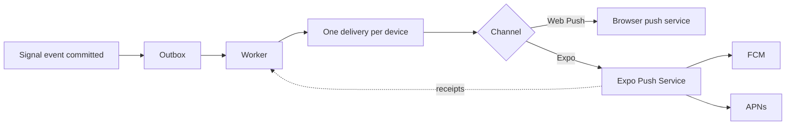

# Mobile app

The primary product: native Android and iOS apps for subscribers and administrators, in `apps/mobile`. React Native with Expo and
TypeScript, using native views, native navigation and native push. There is no WebView anywhere in it.

The app holds no business logic of its own. Levels, validation, previews and display rules come from `packages/domain`, the same
code the API and the web app use, and the server has the final say on everything.

## Run it

You need the API running somewhere the phone can reach. **`localhost` on a phone means the phone**, not your computer.

| Where the app runs                 | API address                        | Also needed                               |
| ---------------------------------- | ---------------------------------- | ----------------------------------------- |
| Android emulator                   | `http://localhost:4000`            | `adb reverse tcp:4000 tcp:4000`           |
| Android emulator, no `adb reverse` | `http://10.0.2.2:4000`             |                                           |
| iOS simulator                      | `http://localhost:4000`            | A Mac with Xcode                          |
| A real phone on the same Wi-Fi     | `http://<this computer's IP>:4000` | Leave it unset and the app works this out |

```bash
npm run db:start
```

```bash
npm run dev
```

```bash
cp apps/mobile/.env.example apps/mobile/.env.local
```

```bash
npm run mobile
```

Then press `a` for Android, or scan the QR code with Expo Go on a phone. Set `EXPO_PUBLIC_API_URL` in `.env.local` if the table
says so.

Expo Go is enough for everything except notifications, which need a real build. On iPhone, Expo Go also requires the phone and this computer to be signed in to the same Expo account, so run `npx expo login` here first.

## Screens

| Who           | Screens                                                                                                                                                                                                     |
| ------------- | ----------------------------------------------------------------------------------------------------------------------------------------------------------------------------------------------------------- |
| Anyone        | Sign in, first password, two-step setup and verification, recovery codes, risk disclosure and privacy                                                                                                       |
| Subscriber    | Signals (trades grouped with their updates), Alerts, News, History, trade detail, Account, first-use tour, access-ended                                                                                     |
| Administrator | Desk, compose, trades, trade detail with every action, subscribers (with registered phones), performance, notification health, announcements and composer, instruments, history management, drafts, account |

Managed on the web only, because they are set rarely and are easier to check on a large screen: message templates,
service settings, compliance approvals and the audit log.

### Signals, filters and hiding

- **Signals** shows one card per trade, newest activity first. The levels on the card are the trade's current ones, the
  latest update is shown prominently, and up to three earlier ones fold away. A new update moves its trade to the top; it
  never becomes a separate card.
- **Instruments** opens a searchable, multi-select list; **Filters** holds status and direction, with a count of what is
  on. Each active filter shows as a chip that removes itself. Choices are saved on the phone and applied by the server.
- **Hide** (the ⋯ on a card) affects only this subscriber, with Undo. Hidden trades stay in History, where they can be
  shown again, and their alerts still arrive.
- **Alerts** lists every notification with read state. Opening the tab clears the badge after a moment; opening a trade
  marks its alerts read. **News** shows announcements, pinned first.

### First use, haptics and controls

A five-step tour follows the first sign-in: reading a signal, updates, alerts (with the permission prompt only if the
person chooses), filters and hiding. It can be skipped and replayed from Account, and finishing it is stored on the server.
Haptics confirm actions and alerts and can be switched off in Account. Every control is at least 44 points, and the
emulator journeys check this at six sizes. The exit-time override when closing a trade is also web only: on a phone
an exit is recorded as now.

## How it connects

- **Sign-in:** `POST /auth/token` returns a session token in the body. It is kept in the device's secure storage (Keychain or
  Keystore), never leaves the device in a backup, and is sent as `Authorization: Bearer`. The server stores only its hash, exactly as
  it does for browser sessions.
- **Same rules as the web:** the same session table, the same forced password change and administrator two-step verification, the
  same subscription check on every request. A bearer token is accepted only with no browser `Origin`, or on the WebSocket, where
  React Native sends its own.
- **Live updates:** the same WebSocket and sequence protocol, using `LiveConnection` from `packages/domain`. On returning to the
  foreground or regaining a network it reconnects and replays what it missed, exactly once and in order.
- **Staying signed in:** subscriber sessions extend while in use, so alerts do not stop for someone who opens the app regularly.

## Notifications



- Native devices are a second channel in the pipeline the web already uses, so eligibility checks, retries, duplicate protection
  and dispatch reporting are the same code.
- **Access is re-checked at send time.** Someone who expired while a message was queued does not get it.
- **Messages go to Expo in batches of up to 100.** If Expo rejects a whole batch, it is split and tried again, so one bad token fails
  alone and cannot hold back everyone else's alert.
- A device Expo reports as `DeviceNotRegistered`, at send or later in a receipt, is removed. Rate limits and server errors retry
  with backoff. Other rejections fail permanently and show in notification health.
- Tapping a notification opens the trade, fetched fresh, so an old notification can never show old levels as current. Only
  known paths are accepted from notification data. A tap that launched the app is held until the person is signed in.
- **While the app is open** the system banner stays quiet and the app shows its own banner, once per event, whether the
  event came over the live connection or as a push. A push also triggers catch-up, so lists refresh.
- Each message carries the trade, its sequence number and version, so the app can order and de-duplicate. iPhone
  notifications are grouped per trade and carry the subscriber's unread count as the badge.
- iPhone interruption levels: time-sensitive for actionable events (new signal, stop-loss move, close, cancellation,
  urgent instruction, priority), active for routine updates and announcements, passive for learning notes. Critical alerts
  are never used. Time-sensitive delivery needs the capability enabled on the App ID.
- Opening a notification is reported, which is the only receipt a phone can give. Notification health shows queue,
  provider-acceptance and open timings at p50, p95 and p99, and raises plain alerts for backlogs and failure rates, which
  the worker also logs as `notification_backlog`.
- Android has three channels, so a person can silence routine updates and keep new signals: `signals`, `updates`, `announcements`.
- Administrators see what the transport did, never who saw it. **A push service accepting a message does not mean it arrived.** The app
  says so to subscribers too, and tells them to check the app before acting.

## One account per phone, and screen protection

See [SECURITY.md](SECURITY.md#one-subscriber-per-phone). In short: a phone is bound to the first subscriber who signs in
on it, a second account is refused with a message that says to ask the administrator, and the administrator releases it
from the subscriber's page. Subscriber screens are blank in Android screenshots and recordings; on iPhone protection is
best effort, with a logged notice. No watermark is drawn over the screens.

For automated screenshots in a development bundle only, start Metro with `EXPO_PUBLIC_E2E_ALLOW_CAPTURE=1`.

## Builds

Three variants, chosen by `APP_VARIANT`:

| Variant       | Application id           | Name               | Network rules                                     |
| ------------- | ------------------------ | ------------------ | ------------------------------------------------- |
| `development` | `com.signaldesk.app.dev` | SignalDesk Dev     | Plain HTTP allowed, for a server on this computer |
| `preview`     | `….preview`              | SignalDesk Preview | HTTPS only. The app refuses to start otherwise    |
| `production`  | `com.signaldesk.app`     | SignalDesk         | HTTPS only. The app refuses to start otherwise    |

The identifiers are placeholders. Set `APP_BUNDLE_ID` once you have registered your own, because they cannot be changed after a store
release.

With an Expo account, from `apps/mobile`:

```bash
npx eas-cli init
```

```bash
EXPO_PUBLIC_API_URL=https://api.your-domain npx eas-cli build --profile preview --platform android
```

```bash
EXPO_PUBLIC_API_URL=https://api.your-domain npx eas-cli build --profile production --platform all
```

Nothing is ever submitted to a store by these commands, or by CI.

Without an Expo account, CI compiles an installable test APK on every push: see the `android-apk` job. The `ios-build` workflow
compiles for the iOS simulator when run by hand. Its macOS minutes cost ten times as much, so it does not run automatically.

## Sharing a test build with someone elsewhere

Their phone has to reach your API, so that needs an HTTPS address first. For a short demo, a temporary tunnel works:

```bash
cloudflared tunnel --url http://localhost:4000
```

This puts your development server on the public internet for as long as it runs. The address changes every time, and your computer has to stay on and awake.

| Their phone | How                                                                                                                                                                               |
| ----------- | --------------------------------------------------------------------------------------------------------------------------------------------------------------------------------- |
| Android     | Set the `SHARE_API_URL` repository variable to that address and push to the `share/android` branch. CI builds an APK, which they install directly. Rebuild if the address changes |
| iPhone      | TestFlight, which needs an Apple Developer account. Expo Go only opens a project on iPhone when the phone and your computer are signed in to the same Expo account                |

The APK is signed with a public debug key, so phones warn about it and it must not be used for anything beyond testing. Until notifications are set up it says "Not set up in this build" under Alerts, and alerts arrive only while the app is open.

To switch notifications on in that APK (all three are needed; nothing secret goes in the repository):

1. Create the Expo project once: `npx eas-cli init` in `apps/mobile`, signed in to your Expo account. Put the project ID it prints in the repository variable `EAS_PROJECT_ID`.
2. In a Firebase project, add an Android app with the package `com.signaldesk.app.preview`. Store its `google-services.json` as the repository secret `GOOGLE_SERVICES_JSON` (`gh secret set GOOGLE_SERVICES_JSON < google-services.json`). The build writes it to a temporary file and never prints it.
3. In Firebase, create a service account key (Project settings, Service accounts) and upload it on expo.dev under the project's Credentials, Android, FCM V1 service account key. It stays with Expo: never in the repository, a variable or a chat.

The app checks that the build contains Firebase before it offers to turn alerts on, so a half-configured build says it is not set up rather than failing. Do not expose the development bundler on the internet: only the API needs to be reachable, because the APK carries the app itself. Use made-up signals only.

## Updates without a new APK

Release builds that talk to an HTTPS server fetch new versions of their screens, wording and images from that server
(`/api/v1/app-updates/manifest`, version 1 of the Expo Updates protocol). No Expo account or third-party service is
involved.

- **When it arrives.** The app asks at launch without delaying it, and again when it returns to the foreground at most
  every half hour. A downloaded version starts the next time the app is opened; a short notice and a row on the
  Account screen offer to restart now. Nothing restarts on its own while someone is reading a signal.
- **Signed.** Every answer is signed with a private key that only the server holds; its certificate,
  `code-signing/certificate.pem`, is compiled into the APK. The app rejects anything unsigned or signed by another
  key, and checks every file against a hash inside the signed manifest. Losing the key means a new APK with a new
  certificate; a leaked key means the same, at once. The key is never in the repository, CI or chat.
- **Which phones.** `runtimeVersion` is a fingerprint of everything native: Expo SDK, native libraries, permissions,
  plugins, icons. An update reaches only APKs with the same fingerprint, so code that needs a newer APK can never be
  sent to an older one. Changes like those need a new APK; screens, wording, logic and images do not.
- **Recovery.** If an update crashes at launch, the library returns to the previous working version. Publishing a
  `rollback` folder (see [DEPLOYMENT.md](DEPLOYMENT.md#app-updates)) sends every phone back to the code inside its APK.
- **Packaging.** `node scripts/export-update.mjs <folder>` in `apps/mobile`, in the same environment as the APK build.
  The `share/android` workflow does this after compiling the APK and refuses to publish an artifact whose fingerprint
  differs from the APK's.

Development builds use Metro and never check for updates, and neither do builds without an HTTPS server address.

## What you need to provide

Nothing below can be done on your behalf, and none of it is needed until the step it unlocks.

| Needed                                       | For                                               | Cost             | Where it goes                                                                                                           |
| -------------------------------------------- | ------------------------------------------------- | ---------------- | ----------------------------------------------------------------------------------------------------------------------- |
| Expo account and project (`eas init`)        | Any real push token, and cloud builds             | Free tier exists | `EAS_PROJECT_ID` in the build environment                                                                               |
| Firebase project with an Android app         | Android push                                      | Free             | `google-services.json`, as an EAS secret file via `GOOGLE_SERVICES_FILE`. Upload the FCM v1 service account key to Expo |
| Apple Developer Program membership           | Any install on a real iPhone, push, and App Store | USD 99 a year    | EAS manages certificates and the push key once signed in                                                                |
| Google Play Console account                  | Play Store                                        | USD 25 once      | Your account. The first upload is manual                                                                                |
| Your own application identifiers             | Store listings                                    | None             | `APP_BUNDLE_ID`                                                                                                         |
| A production HTTPS API                       | Every non-development build                       | Hosting          | `EXPO_PUBLIC_API_URL`                                                                                                   |
| Expo push security token (optional, advised) | Stops anyone with a device token sending to it    | None             | `EXPO_ACCESS_TOKEN` on the **server**, and turn on enhanced security in Expo                                            |
| Legal review                                 | Taking real subscribers                           | Your counsel     | [COMPLIANCE_CHECKLIST.md](COMPLIANCE_CHECKLIST.md)                                                                      |

**Never commit any of these.** `.gitignore` and `scripts/scan-secrets.mjs` refuse the usual file types, and CI checks again.

## Store review: raise these with your counsel before submitting

These are risks I can flag but not settle. Read the current policies, because they change.

- **Apple's guidelines** have a rule about apps for financial trading and investing being submitted by the financial institution
  performing those services. This app never places trades, but a reviewer may still ask. Have your regulatory position ready.
- **Google Play** has a financial features declaration, and specific rules by country for investment-related apps.
- **Account deletion:** both stores require it in the app for apps that let people create accounts. Here only an administrator creates
  accounts, so it may not apply, but be ready to explain that. There is no self-service deletion today.
- **Data safety forms and privacy labels** have to be filled in by you. The app collects sign-in details, device model, push tokens and
  account activity. It has no analytics or advertising SDKs.
- **Reviewers need a working demo account**, with no real signals in it.

## Testing

See [TESTING.md](TESTING.md). To run the end-to-end journeys on an emulator:

```bash
node apps/mobile/e2e/stack.mjs
```

```bash
adb reverse tcp:4200 tcp:4200
```

```bash
adb reverse tcp:8081 tcp:8081
```

```bash
EXPO_PUBLIC_API_URL=http://localhost:4200 npx expo start --localhost
```

```bash
node apps/mobile/e2e/run.mjs
```

`stack.mjs` starts its own PostgreSQL, API and worker on a temporary directory, and never touches your development database.
